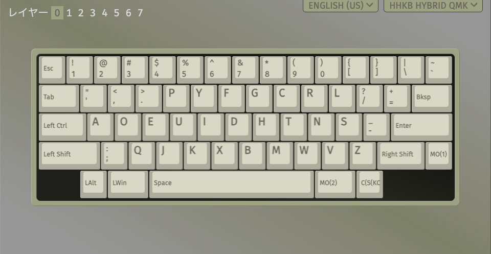
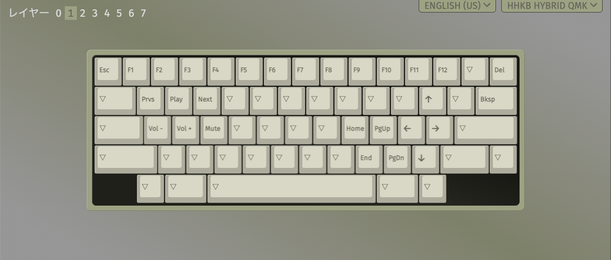
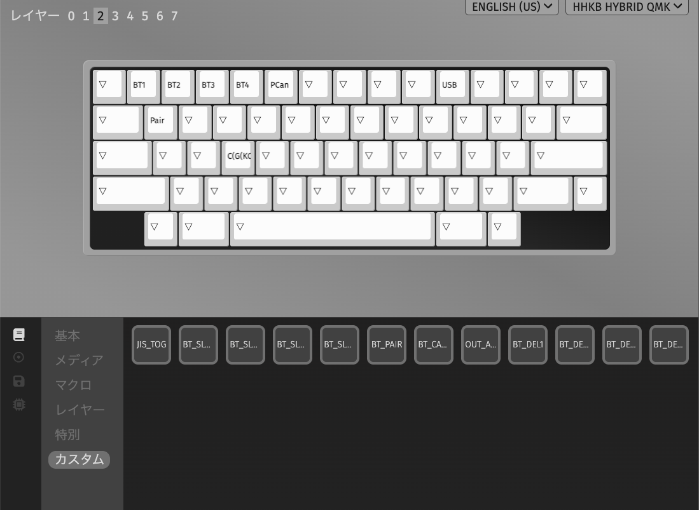
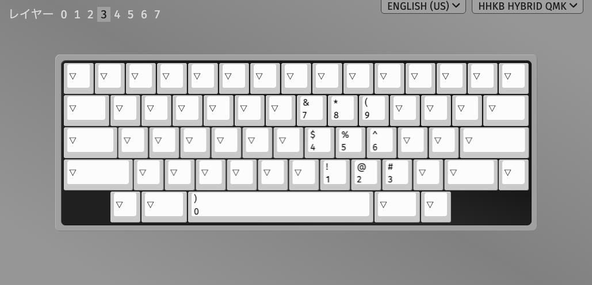
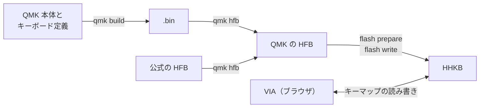

# HHKB Professional Hybrid QMK

[English](README.md) | 日本語

HHKB Professional Hybrid（英語配列）向けの QMK をビルドして書き込む非公式の CLI です。

現在は下記の製品を、macOS で書き換えられることを確認しています。

- HHKB Professional HYBRID Type-S（英語配列）

## 免責事項

⚠️ 利用する前に確認してください。

- 本プロジェクトは PFU Limited および HHKB とは無関係の非公式なものです。本プロジェクトについて PFU に問い合わせないでください。記載の製品名は各社の商標または登録商標です
- 内容は無保証です。キーボードの故障、データの消失、その他の損害を含め、利用は自己責任です。公式以外のファームウェアを書き込むと、メーカーの保証を受けられなくなる可能性があります
- 本リポジトリは、公式ツール、公式ファームウェア、そこから抽出したデータを含まず、配布しません。公式ツールとファームウェアの利用には、PFU の使用許諾と法令が適用されます。参考実装 [l3tnun/hhkb_hybrid](https://github.com/l3tnun/hhkb_hybrid) は submodule で参照するだけです

## QMK と VIA

QMK はキーボードのファームウェアです。本リポジトリでは `default` と `via` の 2 つの keymap をビルドできます。`via` を書き込むと、ブラウザで [VIA](https://usevia.app) を開き、ビルドし直さずにキーマップを変更できます。

### `via` を書き込むとできるようになること

- 公式のキーマップ変更ツールでは実現できなかったキーマップ変更（特別な機能を割り当てられた一部のキーの変更など）ができるようになります
- 8 レイヤー使えるようになります
- Bluetooth の接続先の切り替えやペアリングの開始などを、専用のキーとして任意の位置に割り当てられます



VIA でキーマップを Dvorak 配列に変更した例です。



Fn キーを押している間に使うレイヤー 1 の例です。Dvorak 配列では右 Shift の左隣のキーが Z です。公式のキーマップ変更ツールでこのキーに Z を割り当てると、Fn レイヤーも Z で上書きされ、従来の位置で下矢印を入力できなくなりました。VIA ではレイヤーごとに割り当てられるので、Z と下矢印を同じキーに置けます。



レイヤー 2 に Bluetooth の専用キーを割り当てた例です。画面下の「カスタム」には、参考実装が用意した次のようなキーが並びます。

| キー | 配置後の表示 | 動作 |
|---|---|---|
| `BT_SLOT1`〜`BT_SLOT4` | `BT1`〜`BT4` | Bluetooth の接続先を切り替える。ペアリングモード中は、その接続先に登録する |
| `BT_PAIR` | `Pair` | ペアリングモードに入る |
| `BT_CANCEL` | `PCan` | ペアリングモードを取り消す |
| `OUT_AUTO` | `USB` | 出力を自動（USB 優先）に戻す |
| `BT_DEL1`〜`BT_DEL4` | `BDel1`〜`BDel4` | ペアリングモード中に押すと、その接続先の登録を削除する |



レイヤー 3 をテンキーにした例です。

## 仕組み

HHKB の更新モードを使って、キーボードのファームウェアを QMK に置き換えます。

HHKB には、キー入力を処理する STM32 と、Bluetooth を担当する nRF の 2 つのチップがあります。QMK を書き込む先は、STM32 のアプリ領域です。

| 書き込み先 | 公式ファームウェアでの内容 | QMK を適用した後 |
|---|---|---|
| STM32 のブートローダ領域 | 起動と更新モードの処理 | 変更しない |
| STM32 のアプリ領域（64 KiB） | 公式ファームウェア | QMK に置き換わる |
| STM32 の EEPROM | キーマップと設定 | `via` では VIA の変更をここに保存する |
| nRF | Bluetooth のファームウェア | 変更しない |



1. **QMK のビルド（`qmk build`）**: [参考実装](https://github.com/l3tnun/hhkb_hybrid)にある HHKB 用のキーボード定義と QMK 本体を Docker でビルドし、`.bin` を作ります
2. **更新ファイルの生成（`qmk hfb`）**: 公式の更新ファイル（HFB）のうち、キー入力を処理する STM32 のアプリ領域を `.bin` に置き換え、チェックサムを計算し直します。Bluetooth を担当する nRF のイメージは公式のものをそのまま使います
3. **書き込み（`flash prepare`、`flash write`）**: HHKB を更新モードへ移行し、生成した HFB を USB から書き込みます

`via` でビルドした QMK は、VIA からの読み書きに応答します。VIA はブラウザから USB 経由でキーマップを読み書きし、変更はキーボードに保存されます。公式ファームウェアのままでは VIA を使えないので、QMK に置き換えます。

公式ファームウェアへ戻すときは、公式の HFB を同じ手順で書き込みます。

チップと領域の用途は[参考実装の資料](https://github.com/l3tnun/hhkb_hybrid/blob/0099ac64d30a0530714844fe1fcbaff230fc65fa/docs/hardware.md)にもとづきます。

## 注意事項

- 英語配列以外の機種は未検証です
- `hhkb flash` は公式ファームウェア `A0.48` を前提としています
- QMK の動作中は公式ツールを起動しないでください。送信内容が未確認で、公式ファームウェアを前提とする書き込みが発生する可能性があります
- ファームウェアの書き込み中は、USB ケーブルを抜かず、PC をスリープさせないでください
- ビルドした `.bin` と生成した `.hfb` は公開も配布もしないでください

## 必要なもの

- macOS と Rust のツールチェーン。手順は macOS を前提としています
- 公式の更新ファイル `local/HHKB800_FW_A048.hfb`。本リポジトリには含まないので、利用者自身で用意してください
- Docker Desktop
- もう 1 枚のキーボード
- WebHID に対応したブラウザ（Chrome、Edge など）

## QMK の適用

VIA でキーマップを変更できる `via` を適用します。VIA を使わない場合は、コマンドと確認文の `via` を `default` に置き換えます。

コマンドはリポジトリのルートで実行します。

### 1. ビルドの準備

```console
$ git submodule update --init third_party/hhkb_hybrid
$ git -C third_party/hhkb_hybrid submodule update --init --depth 1 qmk_firmware
$ git -C third_party/hhkb_hybrid/qmk_firmware submodule update --init --depth 1 lib/chibios lib/chibios-contrib lib/lufa lib/printf
```

### 2. ビルドと HFB の生成

Docker Desktop を起動してから実行します。`docker` コマンドが見つからないときは、Docker Desktop の CLI を PATH に追加してください。この時点では HHKB に接続しません。

```console
$ cargo run -p hhkb -- qmk build via
$ cargo run -p hhkb -- qmk hfb via --bin local/qmk-build/via-arm64/hhkb_hybrid_via.bin --stock local/HHKB800_FW_A048.hfb --out local/hhkb_hybrid_via.hfb
```

### 3. 書き込む前の確認

1. 別のキーボードを PC につなぐ。書き込み中は HHKB で一時的に入力できなくなります
2. 公式ツールで現在の設定を `.hks` に保存する
3. 公式ツールと、ブラウザの VIA のタブを閉じる
4. HHKB を PC に USB で直接つなぐ

### 4. 書き込み

1. HFB の種類と接続状況を確認します。HHKB には送信しません

   ```console
   $ cargo run -p hhkb -- flash plan local/hhkb_hybrid_via.hfb
   ```

2. 更新モードへ移行します。確認文は `prepare via` です

   ```console
   $ cargo run -p hhkb -- flash prepare local/hhkb_hybrid_via.hfb
   ```

3. HHKB からキー入力できないことを確認します。USB の表示では公式ファームウェアと更新モードを区別できません。キー入力できるときは次へ進まないでください

4. 本体を書き込みます。確認文は `write via` で、別のキーボードで入力します

   ```console
   $ caffeinate -i cargo run -p hhkb -- flash write local/hhkb_hybrid_via.hfb
   ```

5. USB の表示とキー入力を確認します

### 5. 書き込んだ後

HHKB は VIA の公式リストに載っていないので、最初に定義ファイルを読み込みます。

1. HHKB を USB で接続したまま、ブラウザで [VIA](https://usevia.app) を開く
2. 右上の歯車（Settings）で **Show Design tab** をオンにする
3. **Design** タブの **Load Draft Definition** で `third_party/hhkb_hybrid/via/hhkb_hybrid.json` を選ぶ
4. **Configure** タブの **Authorize device** で `HHKB Hybrid QMK` を選んで接続する

定義はブラウザに保存されるので、次回からは 4 だけで接続できます。別のブラウザや PC を使うときや、サイトデータを消したときは読み込み直してください。

- VIA で接続エラーが出たときは、ページを再読み込みしてください
- Bluetooth で接続できないときは、接続先を登録し直してください。Mac の Bluetooth の一覧に古い接続が残っていた場合は、削除してから登録し直してください

## 公式ファームウェアへ戻す

[書き込む前の確認](#3-書き込む前の確認)の後に実行します。キー入力できないことを確認してから `flash write` を実行してください。

```console
$ cargo run -p hhkb -- flash plan local/HHKB800_FW_A048.hfb
$ cargo run -p hhkb -- flash prepare local/HHKB800_FW_A048.hfb
$ caffeinate -i cargo run -p hhkb -- flash write local/HHKB800_FW_A048.hfb
```

## 動かなくなったとき

⚠️ 手順の多くは未検証です。書き込みを中止したときは、CLI が表示する到達した段階と次の手順も確認してください。

まず状態を確認します。

```console
$ cargo run -p hhkb -- list
```

| 症状 | 考えられる状態 | 対処 |
|---|---|---|
| キー入力できる | ファームウェアが動作中 | 復旧は不要です |
| `HHKB-Hybrid` と表示され、キー入力できない | 更新モード | USB を抜き差しし、公式 HFB で `flash write` を実行します |
| `HHKB Hybrid QMK` と表示され、`flash prepare` が失敗する | QMK が動作中 | 電源を切り、Esc を押したまま USB を接続して更新モードへ入り、`flash write` を実行します |
| `flash write` が同じ位置で止まる | Bluetooth 接続の影響の可能性 | ペアリングを削除し、USB を抜き差ししてやり直します |
| USB に表示されない | 認識の失敗、または起動できない状態 | 次の順に試します |

USB に表示されないとき:

1. ケーブルを替え、ハブを外して、PC の別のポートに直結する
2. 電池を外し、USB を抜いて 10 秒待ち、USB だけで接続する
3. Esc を押したまま USB を接続する
4. 別の PC で認識を確認する

うまくいかないときは、[参考実装の資料](https://github.com/l3tnun/hhkb_hybrid/blob/0099ac64d30a0530714844fe1fcbaff230fc65fa/docs/recovery.md)を参照してください。

## コマンド

`cargo run -p hhkb -- <コマンド>` で実行します。`<keymap>` は `default` または `via` です。

| コマンド | 内容 | HHKB への送信 |
|---|---|---|
| `list` | USB の情報と推定した状態を表示する | なし |
| `status` | 状態と応答の概要を表示する | 公式ファームウェアまたは更新モードに見えるときだけ `02` |
| `inspect <HFB>` | HFB の領域、整合性、機種、バージョンを表示する | なし |
| `flash plan <HFB>` | HFB の種類、パケット数、接続状況を表示する | なし |
| `flash prepare <HFB>` | 更新モードへ移行する | 移行のレポート |
| `flash write <HFB>` | 更新モードの HHKB に本体を書き込む | 本体 |
| `qmk build <keymap>` | QMK をビルドし、`.bin` が想定どおりか照合する | なし |
| `qmk hfb <keymap>` | 公式 HFB と `.bin` から HFB を生成する | なし |

### 制限

- `hhkb flash` で書き込めるのは、許可リストにある公式ファームウェア、`default`、`via` の HFB だけです
- 公式ファームウェアの動作中は、HHKB と HFB のバージョンが一致しないと更新モードへ移行しません
- QMK の動作中や状態を確定できないときは、`flash write` は何も送信しません
- `qmk build` は、参考実装と QMK 本体のコミットを検証してからビルドします。`.bin` が想定と異なるときは 0 以外で終了します。一致してもビルド結果が同じというだけで、動作は保証しません
- `qmk hfb` のテンプレートには、許可した公式 HFB だけを指定できます。出力は `local/` に権限 `0600` で新規作成し、既存のファイルは上書きしません
- ログは `local/logs/` に権限 `0600` で作成します。応答にシリアル番号が含まれるので共有しないでください

## ライセンス

- 参考実装のファイルは MIT、GPL-2.0-or-later、Apache-2.0 が混在します。上流の QMK 本体などは、それぞれのライセンスに従います。正確な内容は参考実装の `LICENSE`、`README.md`、各ファイルの `SPDX-License-Identifier` を確認してください
- `.bin` は QMK 本体（GPL-2.0）と結合したものです。`.hfb` には PFU 製の nRF イメージが含まれます
- これらのライセンスは、PFU の公式ファームウェアや公式ツールと、そこから派生したものには適用されません

## 未検証の項目

- 書き込みが途中で止まった状態からの復旧
- 他の機種での動作
