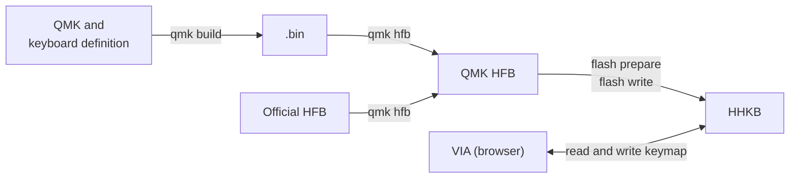

# HHKB Hybrid QMK

English | [日本語](README.ja.md)

An unofficial CLI that builds QMK for the HHKB Professional Hybrid (US layout) and flashes it to the keyboard.

Flashing has been confirmed on macOS with the following product:

- HHKB Professional HYBRID Type-S (US layout)

## Disclaimer

⚠️ Read this before using the project.

- This project is unofficial and is not affiliated with PFU Limited or HHKB. Do not contact PFU about this project. Product names mentioned here are trademarks or registered trademarks of their respective owners
- Everything is provided without warranty. You use it at your own risk, including any damage to the keyboard, loss of data, or other harm. Flashing unofficial firmware may void the manufacturer's warranty
- This repository does not contain or distribute the official tool, the official firmware, or data extracted from them. Use of the official tool and firmware is subject to PFU's license terms and applicable law. The reference implementation [l3tnun/hhkb_hybrid](https://github.com/l3tnun/hhkb_hybrid) is only referenced as a submodule

## QMK and VIA

QMK is keyboard firmware. This repository can build two keymaps: `default` and `via`. After flashing `via`, you can open [VIA](https://usevia.app) in a browser and change the keymap without rebuilding.

### What flashing `via` enables

- Keymap changes that the official keymap tool could not make, such as changing some keys that are assigned special functions
- 8 layers
- Dedicated keys for actions such as switching the Bluetooth connection and starting pairing, which you can place at any position


An example of a keymap changed to Dvorak in VIA.


An example of layer 1, which is active while the Fn key is held. In Dvorak, the key to the left of Right Shift is Z. Assigning Z to this key in the official keymap tool also overwrote its Fn layer with Z, so the down arrow could no longer be typed at its usual position. VIA assigns keys per layer, so Z and the down arrow can share this key.


An example of Bluetooth keys assigned to layer 2. The Custom tab at the bottom of the screen (カスタム in this screenshot) lists keys provided by the reference implementation, such as the following.

| Key | Label after placing | Action |
|---|---|---|
| `BT_SLOT1`–`BT_SLOT4` | `BT1`–`BT4` | Switches the Bluetooth connection. In pairing mode, registers the device to that slot |
| `BT_PAIR` | `Pair` | Enters pairing mode |
| `BT_CANCEL` | `PCan` | Cancels pairing mode |
| `OUT_AUTO` | `USB` | Returns the output to automatic (USB preferred) |
| `BT_DEL1`–`BT_DEL4` | `BDel1`–`BDel4` | In pairing mode, deletes the registration in that slot |


An example of layer 3 set up as a numpad.

## How it works

The CLI uses the HHKB's update mode to replace the keyboard firmware with QMK.

The HHKB has two chips: an STM32 that processes key input and an nRF that handles Bluetooth. QMK is written to the STM32 application area.

| Target | With the official firmware | After applying QMK |
|---|---|---|
| STM32 bootloader area | Startup and update mode | Not changed |
| STM32 application area (64 KiB) | Official firmware | Replaced with QMK |
| STM32 EEPROM | Keymap and settings | With `via`, stores changes made in VIA |
| nRF | Bluetooth firmware | Not changed |



1. **Build QMK (`qmk build`)**: Builds the HHKB keyboard definition from the [reference implementation](https://github.com/l3tnun/hhkb_hybrid) and QMK in Docker, producing a `.bin`
2. **Generate the update file (`qmk hfb`)**: Replaces the STM32 application area of the official update file (HFB) with the `.bin` and recalculates the checksum. The nRF image, which handles Bluetooth, is kept as is from the official file
3. **Flash (`flash prepare`, `flash write`)**: Puts the HHKB into update mode and writes the generated HFB over USB

QMK built with `via` responds to reads and writes from VIA. VIA reads and writes the keymap from the browser over USB, and changes are saved on the keyboard. The official firmware does not work with VIA, so it is replaced with QMK.

To return to the official firmware, flash the official HFB using the same steps.

The purposes of the chips and areas are based on the [reference implementation's documentation](https://github.com/l3tnun/hhkb_hybrid/blob/0099ac64d30a0530714844fe1fcbaff230fc65fa/docs/hardware.md).

## Cautions

- Models other than the US layout have not been tested
- `hhkb flash` assumes the official firmware version `A0.48`
- Do not launch the official tool while QMK is running. What it sends has not been verified, and it may perform writes that assume the official firmware
- While flashing, do not unplug the USB cable or let the computer sleep
- Do not publish or distribute the `.bin` you build or the `.hfb` you generate

## Requirements

- macOS and the Rust toolchain. The steps assume macOS
- The official update file `local/HHKB800_FW_A048.hfb`. It is not included in this repository, so you need to provide it yourself
- Docker Desktop
- A second keyboard
- A browser that supports WebHID (Chrome, Edge, etc.)

## Applying QMK

These steps apply `via`, which lets you change the keymap in VIA. If you do not use VIA, replace `via` with `default` in the commands and confirmation phrases.

Run the commands from the repository root.

### 1. Prepare the build

```console
$ git submodule update --init third_party/hhkb_hybrid
$ git -C third_party/hhkb_hybrid submodule update --init --depth 1 qmk_firmware
$ git -C third_party/hhkb_hybrid/qmk_firmware submodule update --init --depth 1 lib/chibios lib/chibios-contrib lib/lufa lib/printf
```

### 2. Build and generate the HFB

Start Docker Desktop first. If the `docker` command is not found, add the Docker Desktop CLI to your PATH. The CLI does not access the HHKB at this point.

```console
$ cargo run -p hhkb -- qmk build via
$ cargo run -p hhkb -- qmk hfb via --bin local/qmk-build/via-arm64/hhkb_hybrid_via.bin --stock local/HHKB800_FW_A048.hfb --out local/hhkb_hybrid_via.hfb
```

### 3. Before flashing

1. Connect a second keyboard to the computer. The HHKB temporarily cannot type during flashing
2. Save the current settings to a `.hks` file with the official tool
3. Close the official tool and any browser tab with VIA open
4. Connect the HHKB directly to the computer over USB

### 4. Flash

1. Check the HFB type and the connection. Nothing is sent to the HHKB

   ```console
   $ cargo run -p hhkb -- flash plan local/hhkb_hybrid_via.hfb
   ```

2. Enter update mode. The confirmation phrase is `prepare via`

   ```console
   $ cargo run -p hhkb -- flash prepare local/hhkb_hybrid_via.hfb
   ```

3. Confirm that the HHKB cannot type. The USB listing cannot distinguish the official firmware from update mode. If the HHKB can type, do not continue

4. Write the firmware. The confirmation phrase is `write via`. Enter it on the second keyboard

   ```console
   $ caffeinate -i cargo run -p hhkb -- flash write local/hhkb_hybrid_via.hfb
   ```

5. Check the USB listing and key input

### 5. After flashing

The HHKB is not on VIA's official list, so load the definition file first.

1. With the HHKB connected over USB, open [VIA](https://usevia.app) in a browser
2. Click the gear icon (Settings) at the top right and turn on **Show Design tab**
3. In the **Design** tab, use **Load Draft Definition** to select `third_party/hhkb_hybrid/via/hhkb_hybrid.json`
4. In the **Configure** tab, use **Authorize device** to select and connect `HHKB Hybrid QMK`

The browser saves the definition, so next time you only need step 4. Load it again when you use another browser or computer, or after clearing site data.

- If VIA shows a connection error, reload the page
- If Bluetooth cannot connect, register the connection again. If an old connection remains in the Mac's Bluetooth list, delete it before registering again

## Returning to the official firmware

Run these after completing [Before flashing](#3-before-flashing). Confirm that the HHKB cannot type before running `flash write`.

```console
$ cargo run -p hhkb -- flash plan local/HHKB800_FW_A048.hfb
$ cargo run -p hhkb -- flash prepare local/HHKB800_FW_A048.hfb
$ caffeinate -i cargo run -p hhkb -- flash write local/HHKB800_FW_A048.hfb
```

## Troubleshooting

⚠️ Most of these steps are untested. If flashing aborts, also check the stage reached and the next steps shown by the CLI.

First, check the state.

```console
$ cargo run -p hhkb -- list
```

| Symptom | Likely state | Action |
|---|---|---|
| The HHKB can type | Firmware is running | No recovery is needed |
| Shown as `HHKB-Hybrid` and cannot type | Update mode | Unplug and reconnect USB, then run `flash write` with the official HFB |
| Shown as `HHKB Hybrid QMK` and `flash prepare` fails | QMK is running | Turn off the power, hold Esc while connecting USB to enter update mode, then run `flash write` |
| `flash write` stops at the same position | Possibly caused by a Bluetooth connection | Delete the pairing, unplug and reconnect USB, and try again |
| Not shown on USB | Not recognized, or cannot start | Try the steps below in order |

When it is not shown on USB:

1. Change the cable, remove any hub, and connect directly to another port on the computer
2. Remove the batteries, unplug USB, wait 10 seconds, and connect over USB only
3. Hold Esc while connecting USB
4. Check whether another computer recognizes it

If this does not help, see the [reference implementation's documentation](https://github.com/l3tnun/hhkb_hybrid/blob/0099ac64d30a0530714844fe1fcbaff230fc65fa/docs/recovery.md).

## Commands

Run commands with `cargo run -p hhkb -- <command>`. `<keymap>` is `default` or `via`.

| Command | Description | Sent to the HHKB |
|---|---|---|
| `list` | Shows USB information and the estimated state | Nothing |
| `status` | Shows the state and a summary of the response | `02`, only when it appears to be the official firmware or update mode |
| `inspect <HFB>` | Shows the HFB's areas, integrity, model, and version | Nothing |
| `flash plan <HFB>` | Shows the HFB type, packet count, and connection | Nothing |
| `flash prepare <HFB>` | Enters update mode | The mode change report |
| `flash write <HFB>` | Writes the firmware to the HHKB in update mode | The firmware |
| `qmk build <keymap>` | Builds QMK and checks the `.bin` against the expected value | Nothing |
| `qmk hfb <keymap>` | Generates an HFB from the official HFB and the `.bin` | Nothing |

### Limitations

- `hhkb flash` can only write the official firmware on the allow list and the `default` and `via` HFBs
- While the official firmware is running, the HHKB does not enter update mode unless its version matches the HFB
- While QMK is running or when the state cannot be determined, `flash write` sends nothing
- `qmk build` verifies the commits of the reference implementation and QMK before building. It exits with a non-zero status if the `.bin` differs from the expected value. A match only means the build output is the same and does not guarantee correct operation
- `qmk hfb` only accepts an allowed official HFB as a template. Output is created as a new file in `local/` with permissions `0600`, and existing files are not overwritten
- Logs are created in `local/logs/` with permissions `0600`. Responses contain the serial number, so do not share them

## License

- Files in the reference implementation use a mix of MIT, GPL-2.0-or-later, and Apache-2.0. Upstream projects such as QMK follow their own licenses. For exact terms, see the reference implementation's `LICENSE`, `README.md`, and each file's `SPDX-License-Identifier`
- The `.bin` is combined with QMK (GPL-2.0). The `.hfb` contains an nRF image made by PFU
- These licenses do not apply to PFU's official firmware or official tool, or to anything derived from them

## Untested

- Recovery from a state where flashing stopped midway
- Operation on other models
