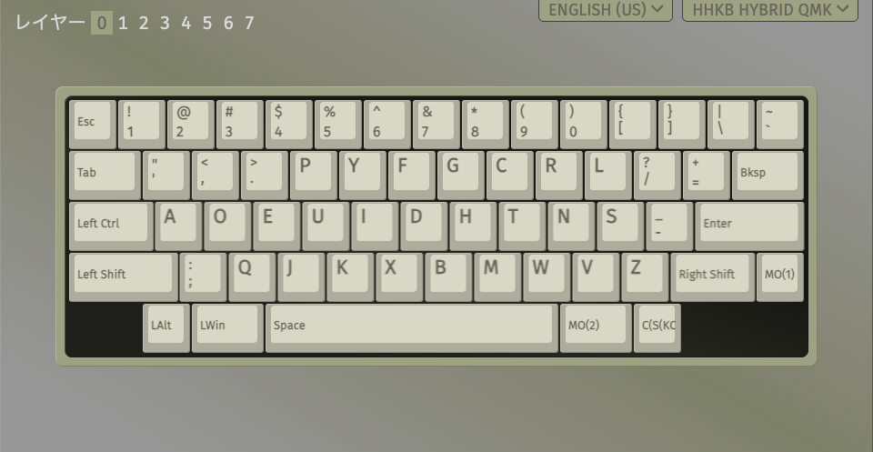

# hhkb_hybrid_qmk

HHKB Professional Hybrid（英語配列）向けの QMK をビルドし、macOS から書き込む非公式の CLI です。公式ファームウェアへ戻すこともできます。

動作を確認した環境は、macOS と英語配列の 1 台だけです。

## VIA でできること

QMK の `via` を適用すると、VIA からキーマップを変更できます。

- 公式のキーマップ変更ツールでは実現できなかったキーマップ変更（特別な機能を割り当てられた一部のキーの変更、Dvorak などの別の配列に変更したままでも今までのような Fn レイヤーをマッピングするなど）ができるようになります
- 3 つ以上のレイヤーを使えます。VIA の画面ではレイヤー 0〜7 を選択できます
- Bluetooth のペアリング切り替えなどの複雑なキーボードショートカットも、任意のキーに割り当てられます



VIA でキーマップを Dvorak 配列に変更した例です。

## 免責事項

⚠️ 利用する前に確認してください。

- 本プロジェクトは PFU Limited および HHKB とは無関係の非公式なものです。本プロジェクトについて PFU に問い合わせないでください。記載の製品名は各社の商標または登録商標です
- 内容は無保証です。キーボードの故障、データの消失、その他の損害を含め、利用は自己責任です。公式以外のファームウェアを書き込むと、メーカーの保証を受けられなくなる可能性があります
- 本リポジトリは、公式ツール、公式ファームウェア、そこから抽出したデータを含まず、配布しません。公式ツールとファームウェアの利用には、PFU の使用許諾と法令が適用されます。参考実装 [l3tnun/hhkb_hybrid](https://github.com/l3tnun/hhkb_hybrid) は submodule で参照するだけです

## 注意事項

- 英語配列以外の機種は未検証です
- 公式ツールが通知するファームウェア更新は適用しないでください。`hhkb flash` は公式ファームウェア `A0.48` を前提としています
- QMK の動作中は公式ツールを起動しないでください。送信内容が未確認で、公式ファームウェアを前提とする書き込みが発生する可能性があります
- ファームウェアの書き込み中は、USB ケーブルを抜かず、PC をスリープさせないでください
- ビルドした `.bin` と生成した `.hfb` は公開も配布もしないでください

## 必要なもの

- macOS と Rust のツールチェーン
- 公式の更新ファイル `local/HHKB800_FW_A048.hfb`。本リポジトリには含まないので、利用者自身で用意してください
- Docker Desktop
- もう 1 枚のキーボード
- macOS から戻せないときに使う [Linux の環境](docs/analysis/findings.md#linux-からの復旧手順)

## QMK の適用

VIA でキーマップを変更できる `via` を適用します。VIA を使わない場合は、コマンドと確認文の `via` を `default` に置き換えます。

コマンドはリポジトリのルートで実行します。

### 1. ビルドの準備

```sh
git submodule update --init third_party/hhkb_hybrid
git -C third_party/hhkb_hybrid submodule update --init --depth 1 qmk_firmware
git -C third_party/hhkb_hybrid/qmk_firmware submodule update --init --depth 1 lib/chibios lib/chibios-contrib lib/lufa lib/printf
```

### 2. ビルドと HFB の生成

Docker Desktop を起動してから実行します。`docker` コマンドが見つからないときは、Docker Desktop の CLI を PATH に追加してください。HHKB には接続しません。

```sh
cargo run -p hhkb -- qmk build via
cargo run -p hhkb -- qmk hfb via --bin local/qmk-build/via-arm64/hhkb_hybrid_via.bin --stock local/HHKB800_FW_A048.hfb --out local/hhkb_hybrid_via.hfb
```

### 3. 書き込む前の確認

- 公式ツールで現在の設定を `.hks` に保存する
- [Linux からの復旧手順](docs/analysis/findings.md#linux-からの復旧手順)を実行できる環境を用意する
- 公式ツールと VIA のタブを閉じる
- USB に接続する HHKB を 1 台にし、ハブを使わず直結する
- HHKB とペアリングした機器の Bluetooth を切る。Bluetooth 接続時に転送が止まる例が参考実装の資料にあります
- 別のキーボードを接続する。更新モードでは HHKB から入力できない可能性があります

### 4. 書き込み

1. HFB の種類と接続状況を確認します。HHKB には送信しません

   ```sh
   cargo run -p hhkb -- flash plan local/hhkb_hybrid_via.hfb
   ```

2. 更新モードへ移行します。確認文は `enter update mode for qmk via` です

   ```sh
   cargo run -p hhkb -- flash enter local/hhkb_hybrid_via.hfb
   ```

3. HHKB からキー入力できないことを確認します。USB の表示では公式ファームウェアと更新モードを区別できません。キー入力できるときは次へ進まないでください

4. 本体を書き込みます。確認文は `write qmk via` で、別のキーボードで入力します

   ```sh
   caffeinate -i cargo run -p hhkb -- flash write local/hhkb_hybrid_via.hfb
   ```

5. USB の表示とキー入力を確認します

### 5. 書き込んだ後

- VIA で接続エラーが出たときは、ページを再読み込みしてください
- Bluetooth で接続できないときは、接続先を登録し直してください。Mac の Bluetooth の一覧に、同じ名前の古い項目が残ることがあります

## 公式ファームウェアへ戻す

[書き込む前の確認](#3-書き込む前の確認)の後に実行します。キー入力できないことを確認してから `flash write` を実行してください。

```sh
cargo run -p hhkb -- flash plan local/HHKB800_FW_A048.hfb
cargo run -p hhkb -- flash enter local/HHKB800_FW_A048.hfb
caffeinate -i cargo run -p hhkb -- flash write local/HHKB800_FW_A048.hfb
```

確認文は、`flash enter` が `enter update mode for stock`、`flash write` が `write stock firmware` です。

`via` から戻すと VIA の設定が消え、公式ファームウェアのキーマップが既定の配置に変わることがあります。`via` を書き込む前に `.hks` を保存し、戻した後に公式ツールで復元してください。

## 動かなくなったとき

⚠️ 手順の多くは未検証です。書き込みを中止したときは、CLI が表示する到達した段階と次の手順も確認してください。

まず状態を確認します。

```sh
cargo run -p hhkb -- list
```

| 症状 | 考えられる状態 | 対処 |
|---|---|---|
| キー入力できる | ファームウェアが動作中 | 復旧は不要です |
| `HHKB-Hybrid` と表示され、キー入力できない | 更新モード | USB を抜き差しし、公式 HFB で `flash write` を実行します |
| `HHKB Hybrid QMK` と表示され、`flash enter` が失敗する | QMK が動作中 | 電源を切り、Esc を押したまま USB を接続して更新モードへ入り、`flash write` を実行します |
| `flash write` が同じ位置で止まる | Bluetooth 接続の影響の可能性 | ペアリングを削除し、USB を抜き差ししてやり直します |
| USB に表示されない | 認識の失敗、または起動できない状態 | 次の順に試します |

USB に表示されないとき:

1. ケーブルを替え、ハブを外して、PC の別のポートに直結する
2. 電池を外し、USB を抜いて 10 秒待ち、USB だけで接続する
3. Esc を押したまま USB を接続する
4. 別の PC で認識を確認する

macOS から戻せないときは、[Linux からの復旧手順](docs/analysis/findings.md#linux-からの復旧手順)を実行します。

最終手段は分解です。詳細は[参考実装の資料](https://github.com/l3tnun/hhkb_hybrid/blob/0099ac64d30a0530714844fe1fcbaff230fc65fa/docs/recovery.md)を参照してください。

## コマンド

`cargo run -p hhkb -- <コマンド>` で実行します。`<keymap>` は `default` または `via` です。

| コマンド | 内容 | HHKB への送信 |
|---|---|---|
| `list` | USB の情報と推定した状態を表示する | なし |
| `status` | 状態と応答の概要を表示する | 公式ファームウェアまたは更新モードに見えるときだけ `02` |
| `inspect <HFB>` | HFB の領域、整合性、機種、バージョンを表示する | なし |
| `flash plan <HFB>` | HFB の種類、パケット数、接続状況を表示する | なし |
| `flash enter <HFB>` | 更新モードへ移行する | 移行のレポート |
| `flash write <HFB>` | 更新モードの HHKB に本体を書き込む | 本体 |
| `qmk build <keymap>` | QMK をビルドし、`.bin` が想定どおりか照合する | なし |
| `qmk hfb <keymap>` | 公式 HFB と `.bin` から HFB を生成する | なし |

### 制限

- `hhkb flash` で書き込めるのは、許可リストにある公式ファームウェア、`default`、`via` の HFB だけです
- 確認を省略するオプションはありません。再送や自動のやり直しもしません
- 公式ファームウェアの動作中は、HHKB と HFB のバージョンが一致しないと更新モードへ移行しません
- QMK の動作中や状態を確定できないときは、`flash write` は何も送信しません
- `qmk build` は、参考実装と QMK 本体のコミットを検証してからビルドします。`.bin` が想定と異なるときは 0 以外で終了します。一致してもビルド結果が同じというだけで、動作は保証しません
- `qmk hfb` のテンプレートには、許可した公式 HFB だけを指定できます。出力は `local/` に権限 `0600` で新規作成し、既存のファイルは上書きしません
- ログは `local/logs/` に権限 `0600` で作成します。応答にシリアル番号が含まれるので共有しないでください

## ライセンス

- 参考実装のファイルは MIT、GPL-2.0-or-later、Apache-2.0 が混在します。上流の QMK 本体などは、それぞれのライセンスに従います。正確な内容は参考実装の `LICENSE`、`README.md`、各ファイルの `SPDX-License-Identifier` を確認してください
- `.bin` は QMK 本体（GPL-2.0）と結合したものです。`.hfb` には PFU 製の nRF イメージが含まれます
- これらのライセンスは、PFU の公式ファームウェアや公式ツールと、そこから派生したものについて権利を与えません

## 未検証の項目

- 書き込みが途中で止まった状態からの復旧
- Esc を押しながら USB を接続して更新モードへ入る手順
- 電源を切った後の設定の保持
- 読み出しに現れないファームウェア内部の状態
- 他の個体と他の機種での動作

## ドキュメント

- [解析記録](docs/analysis/findings.md)
- [通信の記録](docs/analysis/traffic-capture.md)
